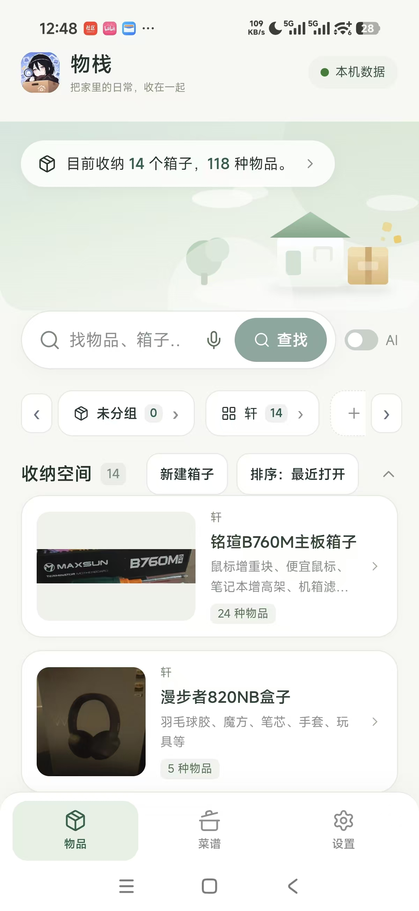
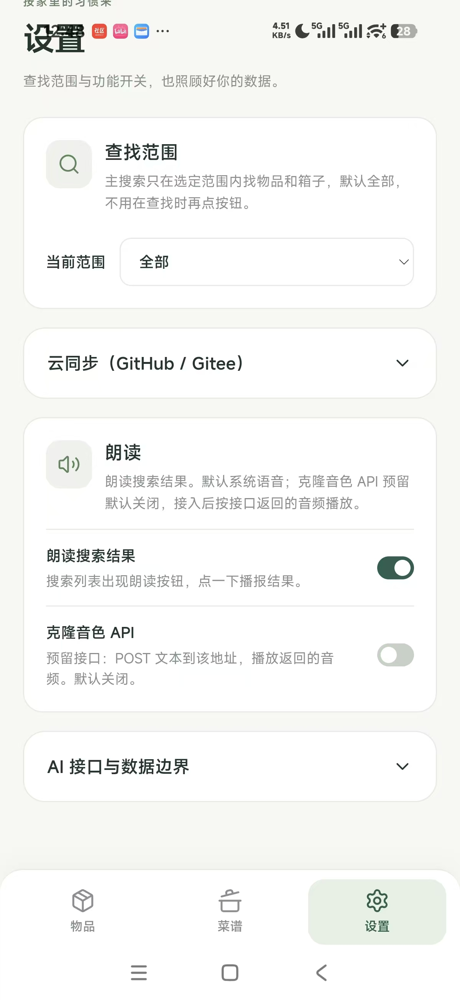

# 我的家 My House（物栈）

> 把家里的日常，收在一起。

**手机单机**的家庭物品收纳 App：数据全部保存在手机本地，通过 GitHub / Gitee 私有仓库同步备份。**无需服务器、无需注册登录**，装上就用，离线可用。

当前版本：2.1.0

| 首页 | 设置 |
| --- | --- |
|  |  |

## 功能一览

- **物品与收纳箱**：箱子分组、封面照片（拍照/上传，内置裁剪，新图自动替换旧封面）、物品数量 / 状态 / 备注 / 标签
- **查找**：全局关键词搜索（查找范围在设置里配置，默认全部）+ AI 自然语言查找（例如「我的耳机在哪里」）+ 语音输入（用输入法自带的麦克风即可）+ 搜索结果朗读
- **收纳空间排序**：最近打开 / 名称 / 物品数量，三种模式循环切换
- **菜谱管理**：菜谱与图片
- **操作历史与撤销**：误删误改可一键还原
- **云同步**：GitHub / Gitee 私有仓库双通道，可只配一个，也可互为备份
- **电脑开关**：局域网内远程唤醒（WoL 魔术包）/ 睡眠 / 关机家里的 Windows、Linux 电脑，配置见 [scripts/pc-agent/README.md](scripts/pc-agent/README.md)

## 使用教程

### 1. 安装

把 `app-debug.apk` 传到手机安装（构建方法见下方「构建」）。系统提示"未知来源"时允许一次即可。

### 2. 首次初始化

打开 App 会进入**初始化页**，三块内容按需填写：

**GitHub 仓库（推荐先配）**

1. 在 GitHub 上新建一个**私有**仓库（例如 `my_house_data`），不需要初始化任何文件
2. 生成令牌：GitHub → Settings → Developer settings → Personal access tokens → **Fine-grained tokens** → 只勾选这个仓库、权限 **Contents: Read and write**
3. 在 App 里填：仓库地址（`https://github.com/你的用户名/my_house_data`）、分支（`main`）、令牌
4. 点 **验证鉴权**——显示 ✓ 即配置成功
5. 老用户：点 **从 GitHub 导入数据** 拉回全部箱子与物品；新用户直接进下一步

**Gitee 仓库（可选，作第二备份）**：同样的流程，令牌在 Gitee → 设置 → 私人令牌（勾选 projects 权限）。

**AI 接口（可选）**：兼容 OpenAI Chat Completions 的任意网关。

- 基础 URL：默认 `http://192.168.3.100:31415/v1`（网关跑在电脑上时，手机要填电脑的**局域网 IP**，不能用 127.0.0.1）
- 模型：`auto` 或指定模型名
- **密钥：由自己手动输入**，只保存在手机本机，不上传、不进同步仓库
- 点 **测试 AI 连接**——显示 ✓ 网关可达，N 个模型可用 即成功

> 没配云仓库也可以点「先离线使用」，之后随时在 设置 → 云同步 里补配。

### 3. 录入数据

**建收纳箱**：首页「新建箱子」→ 填名称、选分组 → 保存。可拍照或选图作封面，裁剪确认后自动替换旧封面（每个箱子只保留一张封面）。

**放物品进去**：点开一个箱子 → 添加物品 → 填名称、数量、状态、备注、标签，可附照片。物品永远挂在箱子下面——找东西就是「打开箱子」这一步。

**整理**：

- 顶部胶囊显示当前收纳概况
- 分组一行横向滑动，两侧箭头翻页；点分组名筛选，再点一次取消
- 「排序」按钮循环三种模式：最近打开 → 名称 → 数量
- 箱子列表默认折叠，点「收纳空间」一行展开

**找东西**：

- 搜索框直接输关键词（范围内找物品和箱子）
- 打开「AI」开关后用自然语言：「我的耳机在哪里」「把充电线移到常用盒子」——AI 给出答案，修改类操作会先让你确认再执行
- 搜索结果可点 🔊 朗读播报

### 4. 云同步

在 设置 → 云同步（折叠区）操作：

- **推送到云端**：把手机上的全部数据提交到仓库（增量上传，附件没变就跳过）。日常改动后随手推一次
- **从云端拉取**：用仓库里的数据整体替换手机数据（有确认弹窗；**先推送再拉取**可防丢失）
- 多台设备共用一个仓库时：改动过的设备先推送，其它设备再拉取
- 换手机 / 重装 App：装好 → 初始化页填同一仓库 → 从云端导入
- **仓库绑定防护**：首次同步后 App 会记住绑定的仓库；之后推送/拉取到**不同仓库**时会弹出强提醒并要求确认，且拉取前自动在本机保留一份**安全快照**（设置 → 云同步底部可一键「恢复快照」，当前数据与快照互换），防止绑错仓库把辛苦录入的数据覆盖掉

### 5. 数据与安全

- 数据保存在手机本地（IndexedDB），附件照片一并存储；**云仓库建议私有**
- 令牌与 AI 密钥只存在手机本机，不上传、不进仓库；泄露了随时在平台端撤销重生成
- 同步时 AI 接口密钥**绝不写入云端仓库**
- 操作历史保留最近 2000 条，支持撤销
- 离线时一切功能可用，联网后再推送同步

## 同步问题排查

| 现象 | 原因与处理 |
| --- | --- |
| 推送提示「仓库与上次不一致」 | App 检测到你换了仓库（防误传保护）。确认是新仓库就点确定；点错了检查一下地址 |
| 拉取后数据不对 | 设置 → 云同步 → **恢复快照**，一键找回拉取前的本机数据（当前数据与快照互换，可反复恢复） |
| 推送/拉取一直失败 | 检查网络（国内连 GitHub 不稳定，可换 Gitee 仓库或开代理）；检查令牌是否过期（重新生成后填入） |
| 两台设备数据对不上 | 约定顺序：改动过的设备**先推送**，其它设备**再拉取**。拉取前 App 会自动保留安全快照 |

## 程序更新（App 版本升级）

App 每天自动检查一次 GitHub Releases，发现新版本会在顶栏提示；也可以在 **设置 → 检查更新** 手动检查并下载 APK（覆盖安装，数据不受影响——更新前记得先推送一次数据）。

完整的发版流程、App 对接 GitHub Releases 的原理和常见问题，见 **[docs/版本更新教程.md](docs/版本更新教程.md)**。

## 常见问题

- **测试 AI 连接提示 401**：网关可达但密钥不对，检查密钥
- **AI 提示连接失败**：手机上地址要用电脑的局域网 IP（如 `http://192.168.3.100:31415/v1`），不能用 127.0.0.1；网关没开也会这样。AI 不可用时自动降级为本地关键词检索
- **封面裁剪**：拖动选区自由裁剪，输出自动限最长边 1600px；照片自动纠正方向、压缩体积
- **换了手机**：新手机初始化页填同一仓库令牌 → 从云端导入即可
- **误拉取了别的仓库**：设置 → 云同步 → 恢复快照，一键找回替换前的数据

## 下载与自动构建（CI/CD）

仓库配置了 GitHub Actions（`.github/workflows/apk.yml`）：每次推送到 master 或手动触发，都会自动**测试 + 构建 APK**，产物上传到 Actions 的 Artifacts（名称 `my-house-apk`）。

获取方式：仓库页面 → **Actions** → 选最新的 "Build APK" 运行 → Artifacts 下载 `my-house-apk`。CI 只产出 APK，**不包含任何密钥或用户数据**。

> 仓库里出现的 `my_house_data` 备份仓库地址、`192.168.3.100:31415` AI 网关地址均为**示例参考**，请替换为你自己的仓库与网关。全仓库不含任何令牌、密钥（CI 有扫描）。

## 构建（开发者）

需要 Node.js 20+、pnpm、JDK 21、Android SDK 36。

```powershell
cd frontend
pnpm install --frozen-lockfile
pnpm test              # 本地数据层测试
pnpm build             # 类型检查 + 生产构建
pnpm exec cap sync android
cd android
gradlew.bat --no-daemon assembleDebug   # 需 ANDROID_HOME 指向 SDK
```

产物：`frontend/android/app/build/outputs/apk/debug/app-debug.apk`。发布请使用固定的 release 签名（签名文件不入库）。

技术栈：Vue 3 + TypeScript + Vite + Capacitor（Android），数据层 IndexedDB（`src/local/`），同步走 GitHub / Gitee Git Data API（`src/local/sync.ts`）。

## 目录结构

```text
frontend/src/
├─ views/            物品、菜谱、设置三个页面
├─ components/       搜索、AI 面板、裁剪、预览、初始化页等组件
├─ local/            本地数据层（IndexedDB 持久化、API 路由、AI、云同步）
├─ composables/      启动、弹窗、查找范围、语音输入、TTS
└─ tests/            本地数据层测试
```

## 说明

- 仓库中的 `backend/`（Spring Boot）与 `deploy/` 是早期"家庭服务器"形态的遗留代码，当前手机 App **不再依赖**它们，仅作历史保留
- 旧版本（服务端形态）的数据库可用迁移脚本转成新格式后从云端导入
