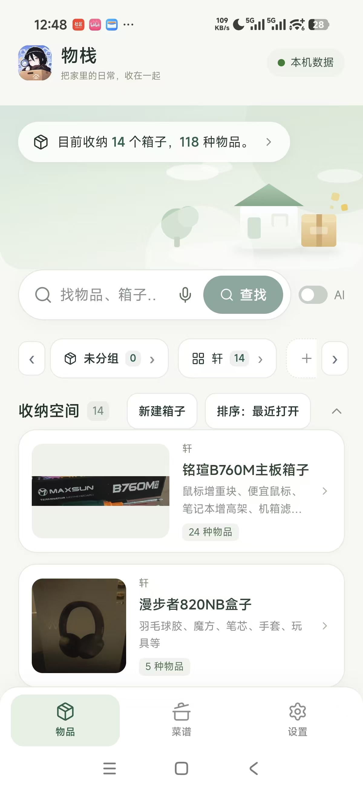
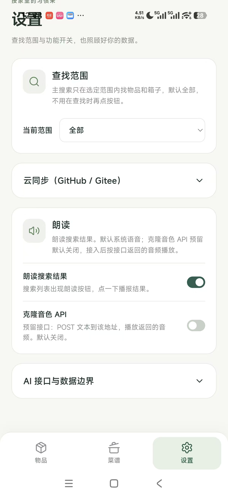

# 我的家 My House（物栈）

> 把家里的日常，收在一起。

**手机单机**的家庭物品收纳 App：数据全部保存在手机本地，通过 GitHub / Gitee 私有仓库同步备份。**无需服务器、无需注册登录**，装上就用，离线可用。

当前版本：3.0.0

| 首页 | 设置 |
| --- | --- |
|  |  |

## 功能一览

- **物品与收纳箱**：箱子分组、封面照片（拍照/上传，内置裁剪，新图自动替换旧封面）、物品数量 / 状态 / 备注 / 标签
- **查找**：全局关键词搜索（查找范围在设置里配置，默认全部）+ AI 自然语言查找（例如「我的耳机在哪里」）+ 语音输入（用输入法自带的麦克风即可）+ 搜索结果朗读
- **收纳空间排序**：最近打开 / 名称 / 物品数量，三种模式循环切换
- **菜谱管理**：菜谱与图片
- **操作历史与撤销**：误删误改可一键还原
- **云同步**：GitHub / Gitee 私有仓库双通道，可只配一个，也可互为备份
- **电脑开关**：局域网内远程唤醒（WoL 魔术包）/ 睡眠 / 关机家里的 Windows、Linux 电脑，配置见 [scripts/pc-agent/README.md](scripts/pc-agent/README.md)
- **健康记录**：体重（小秤指针 + 近 30 次曲线 + 月度图表）与便便一键记录（布里斯托分类、连续天数、日历热力图）

## 使用教程

### 1. 安装

把 `app-debug.apk` 传到手机安装（构建方法见下方「构建」）。系统提示"未知来源"时允许一次即可。

### 2. 首次初始化

打开 App 会进入**初始化页**，三块内容按需填写：

**GitHub 仓库（推荐先配）**

1. 在 GitHub 上新建一个**私有**仓库（例如 `my_house_data`），不需要初始化任何文件
2. 生成令牌：GitHub → Settings → Developer settings → Personal access tokens → **Fine-grained tokens** → 只勾选这个仓库、权限 **Contents: Read and write**
3. 在 App 里**只填令牌**：仓库地址与分支（`main`）已预填，换仓库时直接改地址即可；令牌永远由自己手动输入，代码里没有任何密钥
4. 点 **验证鉴权**——显示 ✓ 即配置成功
5. 老用户：点 **从 GitHub 导入数据** 拉回全部箱子与物品；新用户直接进下一步

**Gitee 仓库（可选，作第二备份）**：同样的流程，令牌在 Gitee → 设置 → 私人令牌（勾选 projects 权限）。

**AI 接口（可选）**：兼容 OpenAI Chat Completions 的任意网关。

- 基础 URL：默认 `http://192.168.3.100:31415/v1`（网关跑在电脑上时，手机要填电脑的**局域网 IP**，不能用 127.0.0.1）
- 模型：`auto` 或指定模型名
- **密钥：由自己手动输入**，只保存在手机本机，不上传、不进同步仓库
- 点 **测试 AI 连接**——显示 ✓ 网关可达，N 个模型可用 即成功

> 没配云仓库也可以点「先离线使用」，之后随时在 设置 → 云同步 里补配。

### 3. 录入数据

**建收纳箱**：首页「新建箱子」→ 填名称、选分组 → 保存。可拍照或选图作封面，裁剪确认后自动替换旧封面（每个箱子只保留一张封面）。

**放物品进去**：点开一个箱子 → 添加物品 → 填名称、数量、状态、备注、标签，可附照片。物品永远挂在箱子下面——找东西就是「打开箱子」这一步。

**整理**：

- 顶部胶囊显示当前收纳概况
- 分组一行横向滑动，两侧箭头翻页；点分组名筛选，再点一次取消
- 「排序」按钮循环三种模式：最近打开 → 名称 → 数量
- 箱子列表默认折叠，点「收纳空间」一行展开

**找东西**：

- 搜索框直接输关键词（范围内找物品和箱子）
- 打开「AI」开关后用自然语言：「我的耳机在哪里」「把充电线移到常用盒子」——AI 给出答案，修改类操作会先让你确认再执行
- 搜索结果可点 🔊 朗读播报

### 4. 云同步

在 设置 → 云同步（折叠区）操作：

- **推送到云端**：把手机上的全部数据提交到仓库（增量上传，附件没变就跳过）。日常改动后随手推一次
- **从云端拉取**：用仓库里的数据整体替换手机数据（有确认弹窗；**先推送再拉取**可防丢失）
- 多台设备共用一个仓库时：改动过的设备先推送，其它设备再拉取
- 换手机 / 重装 App：装好 → 初始化页填同一仓库 → 从云端导入
- **仓库绑定防护**：首次同步后 App 会记住绑定的仓库；之后推送/拉取到**不同仓库**时会弹出强提醒并要求确认，且拉取前自动在本机保留一份**安全快照**（设置 → 云同步底部可一键「恢复快照」，当前数据与快照互换），防止绑错仓库把辛苦录入的数据覆盖掉

### 5. 数据与安全

- 数据保存在手机本地（IndexedDB），附件照片一并存储；**云仓库建议私有**。具体字段与仓库文件结构见下面的「数据格式与仓库结构」
- 令牌与 AI 密钥只存在手机本机，不上传、不进仓库；泄露了随时在平台端撤销重生成
- 同步时 AI 接口密钥**绝不写入云端仓库**
- 操作历史保留最近 2000 条，支持撤销
- 离线时一切功能可用，联网后再推送同步

## 数据格式与仓库结构

数据只有两个地方：**手机里的 IndexedDB**（唯一真实数据源）和**云端仓库里的文件**（备份/换机用）。下面是两边到底长什么样。

### 一、手机本机（IndexedDB 数据库 `myhouse`）

| 对象仓库 | 键 | 值 |
| --- | --- | --- |
| `docs` | `state` | 全部业务数据的 JSON（字段见下一节） |
| `docs` | `snapshot-state` | 拉取前自动保留的快照；「恢复快照」时与 `state` 互换 |
| `blobs` | 附件 id（数字） | `{ mime, bytes: Blob }`，附件字节本体 |
| `blobs` | `snap-<附件id>` | 快照里的附件字节（同样参与互换） |

另有 `localStorage` 只存配置与界面偏好，**不含业务数据**：`myhouse.setupDone`（初始化完成）、`myhouse.cloudProviders`（仓库地址/分支/令牌）、`myhouse.repoBindings`（仓库指纹）、`myhouse.lastSync`（上次同步时间）、`myhouse.snapshotAt`（快照时间）、`myhouse.searchScope`、`myhouse.updateRepo`，以及排序方式、折叠状态、朗读开关、体重单位等 UI 偏好。

### 二、`data.json`（手机格式，`version: 1`）

```jsonc
{
  "version": 1,          // 结构版本，只增字段不改含义
  "seq": 1000,           // 自增 id 计数器；拉取后自动顶到最大 id 之上，避免新建撞 id
  "members": [...],      // 成员
  "groups": [...],       // 分组
  "containers": [...],   // 收纳箱（含 group_id / sort_order / last_opened_at / 摆位 pos_* / size_*）
  "items": [...],        // 物品（container_id / quantity / condition / notes / tags）
  "recipes": [...],      // 菜谱
  "attachments": [...],  // 附件元数据（字节在 attachments/ 目录）
  "history": [...],      // 操作历史（含 before 快照，支持撤销）
  "ai": { "base_url": "", "model": "auto", "api_key": "" },
  "pcs": [...],          // 可缺省：电脑开关配置（MAC/IP/令牌），只存手机
  "health": [...]        // 可缺省：体重与便便，只存手机
}
```

附件行的字段：

| 字段 | 说明 |
| --- | --- |
| `id` | 附件 id，同时是手机格式里的文件名 |
| `item_id` / `container_id` / `recipe_id` | 挂在谁身上（三选一，其余为 `null`） |
| `kind` | `image` / `file` / `video` |
| `filename` | 原始文件名（给人看的） |
| `mime_type` / `size_bytes` | 类型与体积 |
| `stored_name` | **电脑端格式里的相对路径**，如 `container-1/e5d69fcd….jpg`；手机自己传的附件没有这个字段 |

**哪些不上云**：`ai.api_key` 推送前一律置空、拉取后仍用本机的；`pcs` 整段不参与同步；`health` 目前只存在手机上（电脑端数据库没有这张表，拉取时本机记录会被保留）。

### 三、云端仓库（两种格式可以并存）

**A. 手机格式** —— App 读写的就是这套：

```text
data.json                     全部业务数据（上面的 LocalState）
attachments/<附件id>           附件字节，文件名就是 data.json 里的附件 id
backup/meta.json              同步清单：时间、物品/箱子数、每个附件的 sha256（增量上传靠它跳过未变的文件）
```

**B. 电脑端备份格式** —— App 拉取时能识别，但自己不写：

```text
inventory.db                  SQLite 一致性快照（VACUUM INTO，服务运行中也能安全导出）
backup-meta.json              导出时间、体积、箱子名清单
attachments/<实体>/<uuid>.<ext>   按 container-1 / item-9 / recipe-4 分目录存放
```

两者共存时看不出区别，但**电脑端推一次备份会覆盖仓库根目录**，手机就读不到 `data.json` 了 —— 这时跑 `scripts/export-mobile-json.py` 补一份即可（见「同步问题排查」）。

当前数据仓库（`my_house_data`）的实况：18 个文件、4.8MB —— `data.json`(168KB) + `inventory.db`(344KB) + `backup-meta.json` + 15 个附件（14 箱 / 118 物品）。

### 四、附件怎么定位

拉取时按这个顺序找文件，前一个没有才退到下一个：

1. `attachments/<stored_name>` —— 电脑端格式导出的数据带这个字段，路径与仓库实际文件一一对应
2. `attachments/<附件id>` —— 手机自己推送的格式
3. 都找不到就记进「缺失」，界面提示「有 N 个附件在云端找不到文件」，文字数据不受影响

`data.json` 不在根目录也能认出：优先根目录，其次 `backup/data.json`（旧版布局），再其次树里任意位置的 `data.json`。

### 五、同步协议

走平台自带的 Git Data API，不依赖 git 客户端：

```text
推送：blobs（只传变的）→ trees（base_tree 保留仓库里其它文件）→ commits → PATCH ref
拉取：ref → trees?recursive=1 → blobs（data.json + 附件）→ 整体替换本机
```

- 附件按内容 sha256 比对，没改过的跳过上传（清单存在 localStorage `myhouse.lastSync.<provider>.manifest`）
- `base_tree` 是「两种格式能共存」的关键：App 推送不会删掉 `inventory.db`、`backup-meta.json`

## 同步问题排查

| 现象 | 原因与处理 |
| --- | --- |
| 推送提示「仓库与上次不一致」 | App 检测到你换了仓库（防误传保护）。确认是新仓库就点确定；点错了检查一下地址 |
| 拉取后数据不对 | 设置 → 云同步 → **恢复快照**，一键找回拉取前的本机数据（当前数据与快照互换，可反复恢复） |
| 推送/拉取一直失败 | 检查网络（国内连 GitHub 不稳定，可换 Gitee 仓库或开代理）；检查令牌是否过期（重新生成后填入） |
| 两台设备数据对不上 | 约定顺序：改动过的设备**先推送**，其它设备**再拉取**。拉取前 App 会自动保留安全快照 |
| 拉取提示「云端没有 data.json」 | 数据仓库被**电脑端备份格式**覆盖了（只剩 `inventory.db` + `backup-meta.json`）。在电脑上跑 `python scripts/export-mobile-json.py --db inventory.db --out data.json` 后提交，手机就能拉。**不要**在手机上点推送去「修」它——那会拿手机上的旧数据盖掉云端 |

## 程序更新（App 版本升级）

App **每次打开都会自动检查一次** GitHub Releases（从后台切回前台也会补查，5 分钟内不重复请求），发现新版本会轻提示并显示在「设置 → 检查更新」；也可以在那里手动检查并下载 APK（覆盖安装，数据不受影响——更新前记得先推送一次数据）。

完整的发版流程、App 对接 GitHub Releases 的原理和常见问题，见 **[docs/版本更新教程.md](docs/版本更新教程.md)**。

## 常见问题

- **测试 AI 连接提示 401**：网关可达但密钥不对，检查密钥
- **AI 提示连接失败**：手机上地址要用电脑的局域网 IP（如 `http://192.168.3.100:31415/v1`），不能用 127.0.0.1；网关没开也会这样。AI 不可用时自动降级为本地关键词检索
- **封面裁剪**：拖动选区自由裁剪，输出自动限最长边 1600px；照片自动纠正方向、压缩体积
- **换了手机**：新手机初始化页填同一仓库令牌 → 从云端导入即可
- **误拉取了别的仓库**：设置 → 云同步 → 恢复快照，一键找回替换前的数据

## 下载与自动构建（CI/CD）

仓库有两条流水线：

| 工作流 | 触发 | 做什么 |
| --- | --- | --- |
| **CI**（`ci.yml`） | 推到 master、PR、手动 | 版本号一致性检查 → 前端单测 → 类型检查 + 构建；后端 `mvn verify`；测试报告存档 |
| **Build APK**（`apk.yml`） | 推到 master、打 `v*` 标签、手动 | 版本检查 → 测试 → 构建 Web → `cap sync` → 构建 APK |

- 推到 master：产出 **debug APK**，在 Actions 运行页的 Artifacts 里下载 `my-house-apk-debug`
- 打 `v*` 标签：产出**正式签名** APK 并自动发布到 **Releases**，手机端「检查更新」读的就是它

发版三步：改 `frontend/package.json` 的 version 和 `build.gradle` 的 versionName/versionCode（前者必须一致，versionCode 必须 +1）→ `git push` → `git tag vX.Y.Z && git push origin vX.Y.Z`。流水线会拦下版本不一致的提交（`scripts/check-version.mjs`）。

CI 只产出构建产物，**不包含任何密钥或用户数据**；正式签名靠仓库 Secrets：`KEYSTORE_BASE64`、`KEYSTORE_PASSWORD`（缺了会直接失败，不会偷偷用 debug 证书）。

> 仓库里出现的 `my_house_data` 备份仓库地址、`192.168.3.100:31415` AI 网关地址均为**示例参考**，请替换为你自己的仓库与网关。全仓库不含任何令牌、密钥（CI 有扫描）。

## 构建（开发者）

需要 Node.js 20+、pnpm、JDK 21、Android SDK 36。

```powershell
cd frontend
pnpm install --frozen-lockfile
pnpm test              # 本地数据层测试
pnpm build             # 类型检查 + 生产构建
pnpm exec cap sync android
cd android
gradlew.bat --no-daemon assembleDebug   # 需 ANDROID_HOME 指向 SDK
```

产物：`frontend/android/app/build/outputs/apk/debug/app-debug.apk`。发布请使用固定的 release 签名（签名文件不入库）。

技术栈：Vue 3 + TypeScript + Vite + Capacitor（Android），数据层 IndexedDB（`src/local/`），同步走 GitHub / Gitee Git Data API（`src/local/sync.ts`）。

## 目录结构

```text
frontend/src/
├─ views/            物品、菜谱、健康、设置
├─ components/       弹窗、AI 面板、图片裁剪、初始化页等
├─ local/            本地数据层
│  ├─ storage.ts       IndexedDB（docs / blobs）与快照
│  ├─ state.ts         数据模型与派生视图（LocalState 定义在这里）
│  ├─ localApi.ts      把 /api/* 请求在本地解析掉
│  ├─ sync.ts          云同步（推送 / 拉取）
│  ├─ syncFormat.ts    仓库布局识别（纯函数，可单测）
│  ├─ ai.ts / health.ts / pcPower.ts / statusLights.ts
└─ composables/      启动、更新检查、弹窗、查找范围、语音/TTS

frontend/tests/      本地数据层 + 仓库格式解析的单测（vitest）
scripts/
├─ export-mobile-json.py   电脑端 inventory.db → 手机 data.json
└─ check-version.mjs       CI 版本号一致性校验
.github/workflows/   ci.yml（测试+构建）、apk.yml（出包/发版）
```

## 说明

- 仓库中的 `backend/`（Spring Boot）与 `deploy/` 是早期"家庭服务器"形态的遗留代码，当前手机 App **不再依赖**它们，仅作历史保留；不过它导出的 `inventory.db` 仍可作为数据来源，用 `scripts/export-mobile-json.py` 转成手机格式
- 旧版本（服务端形态）的数据库可用迁移脚本转成新格式后从云端导入
